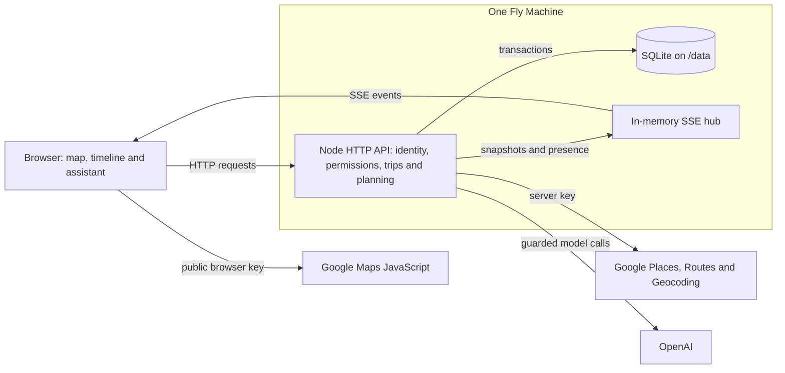

# Process overview — Final

The first part follows my product decisions and the changes that came from using Wayline. The later sections explain the implementation, how agent work was directed and checked, and what the evidence establishes.

- [Product decisions and revisions](#starting-from-a-situation-i-had-actually-experienced)
- [Implementation and engineering trade-offs](#implementation-and-engineering-trade-offs)
- [Directing the agent and correcting its work](#directing-the-agent-and-correcting-its-work)
- [Evidence and remaining limits](#evidence-and-remaining-limits)

## Starting from a situation I had actually experienced

My choices about subject matter and scope start from real situations. Virtual Gym came from training alone in the quiet gym beneath my residence. I wanted the companionship of an online study room, applied to exercise. As I considered more real-time interaction, I struggled to reconcile frequent interaction with the quiet company that had motivated the idea. An equipment-occupancy tool seemed less helpful than asking someone in person. A cooperative RPG offered purposeful interaction, but depended on enough players with the right professions and a substantial art workload.

The turning point was a friend from China visiting Australia and asking for itinerary recommendations. That gave me a planning problem I could experience directly. I replaced the gym with Wayline, retaining the useful technical foundations. [ADR 0005](docs/decisions/0005-project-theme-and-pivot.md) records the full alternatives and reasons; the implemented pivot is visible in [6305228](https://github.com/comp4020-agentic-coding-studio/comp4020-final-lyclccylcq/commit/63052286cdbde3c5d6c61aa8378bb08cf0824a11) and [0953ec9](https://github.com/comp4020-agentic-coding-studio/comp4020-final-lyclccylcq/commit/0953ec90c5d40e864304e5de62b3bad42edcb70a).

## The map had to be a core part of the product

From 9 October onwards, the first core decision was the map. One of the problems I had identified was that fragmented information from social media often gave me very little sense of location. I could decide that I wanted to visit two places and still have poor control over the distance between them. The transport problem would only become clear when I tried to connect the choices into an actual day. Collecting attractive destinations was much easier than understanding whether they belonged in the same itinerary.

For that reason, a visible map was essential. I wanted to see where places were, how far apart they were, and what moving between them would involve while making the plan. For an unfamiliar visitor, the map also has value before a route has been decided: it is a way to explore what is around a destination.

My comparison came from my own habits. In China I was used to local-lifestyle services such as Meituan combining discovery and local information. In the Australian planning situation I was dealing with, I did not have an equivalent single service that I used in the same way. A map remained one of the most useful ways for me to explore locally. This is the practical reason I put Google Maps at the centre of Wayline. The discovery homepage and planning-from-the-map work followed that choice ([4e0b815](https://github.com/comp4020-agentic-coding-studio/comp4020-final-lyclccylcq/commit/4e0b8157a57560564bb7c6168ab5682b1767dda2), [7799fab](https://github.com/comp4020-agentic-coding-studio/comp4020-final-lyclccylcq/commit/7799fabe9bcefd318af9ce95a4833fdd8776f7aa); [ADR 0006](docs/decisions/0006-map-and-shared-planning.md)).

## A shared itinerary had to reduce the delay between people

The second core decision was the shared itinerary. This is where the project's real-time interaction matters most. When planning with my friend, I found that information did not move between us immediately. We could spend time collecting material separately, then discover duplication and conflicting choices when we finally tried to plan together. Similar social-media recommendations made that duplication especially easy: both people could return with many of the same suggestions without knowing what the other had already selected.

I therefore wanted an online space in which we could design the itinerary together. The useful result of real-time interaction would be seeing a choice while it was being made and responding to its effect on the same plan. A change to a place, a time or a route should become shared context for the next decision.

The implementation uses one server-held itinerary, with saved changes sent to open editors through SSE. Version checks make an outdated edit a visible conflict instead of silently losing somebody else's change. [ADR 0003](docs/decisions/0003-sse-snapshots-and-versioned-edits.md) records the transport and concurrency alternatives. My product-level reason for accepting that approach was to keep our decisions connected to one shared plan ([6305228](https://github.com/comp4020-agentic-coding-studio/comp4020-final-lyclccylcq/commit/63052286cdbde3c5d6c61aa8378bb08cf0824a11), [b4bb133](https://github.com/comp4020-agentic-coding-studio/comp4020-final-lyclccylcq/commit/b4bb133f016db3af103e4d7d398ddcef774f4ec6)).

## Sharing a map view came from using the app together

Sharing the map view was a more specific decision that came out of testing and using the project. When we talked about a particular place, the other person often had to search for it before the discussion could continue. Even though we were discussing the same itinerary, we were not necessarily looking at the same information.

Being able to find the place the other person was viewing reduced that interruption. I wanted a clear indication of where they were looking and a quick way to move there. I meant their view of the map, rather than their device's GPS position. I also did not want one person's browsing to keep taking control of everyone else's screen.

This led to separate state for the saved itinerary, temporary collaborator views, and my own selected point. After jumping to a teammate's view, I still needed a way back to my point. The transient view markers and My spot/Return to my spot followed these different needs ([3f27110](https://github.com/comp4020-agentic-coding-studio/comp4020-final-lyclccylcq/commit/3f27110edff0a6fa0d3fada34ab7578daf0f45b8), [1f3d00e](https://github.com/comp4020-agentic-coding-studio/comp4020-final-lyclccylcq/commit/1f3d00e8942dd72cd64f4033d7bef45130a27f8d); [ADR 0006](docs/decisions/0006-map-and-shared-planning.md)).

## Voice was an extra module with a deliberate limit

Voice calling was an additional module. I do not consider it as fundamental as the map or shared itinerary. My starting point was simple: if two people could talk directly while looking at the plan, they would not need to open another calling application just to discuss it. I hoped this would make the real-time experience more immediate and convenient.

I have also reflected on the risk of that choice. The final version supports a call between two people, while itinerary collaboration supports more than two. That mismatch is a genuine limitation. A larger group can plan together, but cannot all use the built-in call at once.

Repeated testing showed how much reliability work voice introduced under the project's conditions. Connection signalling, actual audio playback, recovery and the network path all mattered. A direct peer connection is not available on every network, so a [TURN relay](https://webrtc.org/getting-started/turn-server) is needed as a fallback in those situations. The relay and its bandwidth are separate obligations from serving the planning page; increasing the size of calls would add further complexity. I therefore kept the call at two participants instead of continuing towards a multi-person voice room.

This was a cautious scope decision, not evidence that calling had become reliable everywhere. TURN was provisioned and relay paths were tested, and later fixes addressed silent audio and stuck or lost connections. The remaining device and network limits still matter ([fcf8928](https://github.com/comp4020-agentic-coding-studio/comp4020-final-lyclccylcq/commit/fcf892875dda6a250f20d4d678ef8b24cc088e14), [825820a](https://github.com/comp4020-agentic-coding-studio/comp4020-final-lyclccylcq/commit/825820a99855287fa5ab19a73e342f10cd10d39e), [5e6863c](https://github.com/comp4020-agentic-coding-studio/comp4020-final-lyclccylcq/commit/5e6863c16ab0d8257a79e0ede1caba8f06adeb28); [ADR 0004](docs/decisions/0004-webrtc-voice-calls.md)).

## Deciding what the assistant should actually do

The role of AI was one of the project's central trade-offs. My first reaction was to let it generate an entire itinerary: the user would select very few destinations they were interested in, and the model would plan the rest. I considered that approach, but decided that it did not fit the reason I was building Wayline.

When I begin planning a trip, I normally already have the main places I want to visit. The difficult work is turning those main goals into a complete, workable itinerary. A fully generated trip would still need my review and changes. I was not going to follow a model's recommendations without checking them, so generating everything did not remove the part of the task I actually found difficult.

I chose three practical jobs for the assistant. First, assess the itinerary for timing and route conflicts. Second, help find food along the route according to the user's preferences, so that a restaurant chosen because of a social-media recommendation does not derail the whole day. Third, help with the situation where there is free time and the traveller would like to explore nearby.

These are the assistant's jobs, rather than a requirement to put an LLM behind every action. In the implementation, schedule arithmetic and many suggestions come from rules and Google data; model calls are used for bounded recommendations and day optimisation. The user still chooses and applies the changes. The alternatives and boundaries are recorded in [ADR 0007](docs/decisions/0007-bounded-planning-assistant.md), with the initial planning implementation in [b20fc88](https://github.com/comp4020-agentic-coding-studio/comp4020-final-lyclccylcq/commit/b20fc8895863ef981768b88a3609030ff23ea226).

## My initial permission model was borrowed too casually

I initially paid much less attention to identity and permissions than to the planning experience. I treated the trip rather like an alternative GitHub repository: the owner had broad control, while invited contributors would have stricter limits. That seemed a straightforward way to manage access, and the early model restricted collaborators largely to the stops they had added.

The project also needed a way to identify who had acted and to decide who could join. Invite links were made time-limited, opening one began a request, and the owner approved an identified account. Server-side checks and session-attributed logs gave these boundaries an implementation ([1f973dd](https://github.com/comp4020-agentic-coding-studio/comp4020-final-lyclccylcq/commit/1f973dda60f0d606893cb61ef8866be0b47bad77)).

At this stage, a recognisable larger version of Wayline had formed. However, I had not yet fully examined whether my repository-like permission assumption suited live travel planning. That became an important correction later. [ADR 0008](docs/decisions/0008-planning-rights-and-management.md) records both the initial assumption and its revision.

## Keeping API credentials and consumption under control

Connecting maps, place search, routes and model-assisted planning also made API security an operational decision. My choice was to keep deployment credentials in Fly secrets and add restrictions on API use, including request frequency and usage allowances. I needed to consider both where a key was stored and what could happen when the application used it. Even without a leaked credential, repeated requests through the normal interface could consume a paid service's allowance.

Fly secrets supplies credentials as runtime environment variables, keeping them separate from the source code and image. Local development uses a gitignored configuration file. The deployed application can obtain its configuration independently of my laptop. I also separated the intentionally public Google browser map key from the server key for Places, Routes and Geocoding; the OpenAI key remains on the backend. The browser key needs website/API restrictions because visitors must receive it to load the map ([a32c15b](https://github.com/comp4020-agentic-coding-studio/comp4020-final-lyclccylcq/commit/a32c15b76dda04bee215e8d42459f2f926a42d40)).

For model calls, the implementation provides configurable defaults of 100 admitted requests per UTC day, three concurrent calls and a 400,000-token daily admission threshold, shared across the application. Usage is recorded in SQLite, so restarting against the same retained database does not reset the daily count. Checks and reservations happen together before the provider is contacted, and admitted failures still consume a request. Output limits, timeouts and disabled automatic retries add boundaries to each call ([b20fc88](https://github.com/comp4020-agentic-coding-studio/comp4020-final-lyclccylcq/commit/b20fc8895863ef981768b88a3609030ff23ea226)). Public place and route endpoints also have short-term per-IP throttles, although these counters are held in memory rather than in the persistent AI allowance.

This choice has costs and limits. One person's repeated attempts can exhaust the shared AI allowance, and the token threshold is not an exact monetary ceiling: output is reserved before input usage is known, and completed calls are reconciled using the usage the provider returns. Provider-side API restrictions, quotas and any explicitly enforced spend cap address another part of the risk. A budget notification alone cannot be treated as a stop mechanism, and a key used directly outside Wayline would bypass its application checks. [ADR 0011](docs/decisions/0011-api-credentials-and-usage-controls.md) records these boundaries, the implementation defaults and the distinction from live provider-console settings.

## Changing the assistant from a chatbot into a tool

The next decision was crucial to what I meant by using AI in a product. Claude's earlier implementation felt like a chatbot powered by an LLM. I still had to type a request to make it work, much as I would when using Claude itself. That did not fit the product I wanted.

I did not want a chat-based customer-service assistant beside the itinerary. I wanted an easy-to-use tool: a button should start a defined task, within limits I had chosen for the product. The traveller should not need to learn how to prompt another general-purpose model just to inspect a schedule or look for food.

I therefore changed the visible interaction to buttons and task-specific results. The planning assistant shows the day's state and offers actions such as optimisation, food suggestions and nearby exploration. Suggestions can be previewed and selected before being applied. This made my earlier decision about the assistant's role concrete in the interface ([f99cdf0](https://github.com/comp4020-agentic-coding-studio/comp4020-final-lyclccylcq/commit/f99cdf0fd8eab349be33927f029429835df09a6d)). Later, several fixes could be previewed together, and old suggestions were cleared when the shared day changed ([48c1215](https://github.com/comp4020-agentic-coding-studio/comp4020-final-lyclccylcq/commit/48c1215f7dc005ae3f7edc9249b0afcae5f8b0aa), [9c63890](https://github.com/comp4020-agentic-coding-studio/comp4020-final-lyclccylcq/commit/9c63890d03fb62abda5af5a3e8538d9f3e0579b8); [ADR 0007](docs/decisions/0007-bounded-planning-assistant.md)).

## Restaurant constraints improved through use and crit feedback

Restaurant recommendation needed further work after actual use and feedback from classmates at a crit. Earlier versions did not give me enough control over preferences, and the treatment of search distance was too crude. During crit testing, a destination away from a commercial area or city centre could leave the assistant with no shops to recommend.

That was a practical limit of the feature, rather than a problem that more fluent model text would solve. I revised the search-distance handling and custom preference/tag choices so that recommendations could better reflect both the person and the part of the route being planned. The implementation history includes the planning assistant's route-based searches and the later clearer preference interface ([f99cdf0](https://github.com/comp4020-agentic-coding-studio/comp4020-final-lyclccylcq/commit/f99cdf0fd8eab349be33927f029429835df09a6d), [0b21109](https://github.com/comp4020-agentic-coding-studio/comp4020-final-lyclccylcq/commit/0b21109354401066a91db8898902ec79d0ce41fe)).

Other checks made the recommendations more realistic. Travel should respect the modes the person excluded, and a meal has to fit the restaurant's opening period for the whole visit, including a buffer before closing. Those corrections are visible in [a005e90](https://github.com/comp4020-agentic-coding-studio/comp4020-final-lyclccylcq/commit/a005e902ad410000e0aeb916edb93f1a325c866b) and [e2dae22](https://github.com/comp4020-agentic-coding-studio/comp4020-final-lyclccylcq/commit/e2dae226bf76ce2543417eeb5246db4fe08037a1). The aim was to help build a usable day, with the limits of the available data made clear ([ADR 0007](docs/decisions/0007-bounded-planning-assistant.md)).

## Taking ownership of the design also meant revisiting the code

At first I had given Claude considerable freedom over the visual design. I had not thought through that part of the product in much detail. Later, an evaluation using another model described the first version as generic and recognisably AI-designed. I took that criticism seriously. Even if the result was acceptable as a course prototype, I wanted to keep using and promoting this project after the course. I wanted a stronger design of my own.

Before continuing with more substantial optimisation and visual work, I was also concerned about what repeated additions and repairs had done to the code. This connected to the question I raised around Week 12: an agent can create a complete application, but maintaining and refactoring it may matter even more once it is actually used. Each new function or repair could leave structure and redundancy that were hard for me to see clearly.

I therefore asked for a broader restructuring before continuing the next round of development. The repository shows request logging, planning orchestration and sharing extracted from the larger modules, with tests preserving existing behaviour ([dfce3ef](https://github.com/comp4020-agentic-coding-studio/comp4020-final-lyclccylcq/commit/dfce3ef853434c8d07d79f855dc1daba4a51d119)). That did not mean the whole application had been rewritten or every possible redundancy removed. It was a concrete step towards making later changes and maintenance more manageable. [ADR 0009](docs/decisions/0009-visual-identity-and-maintainability.md) connects this decision to the subsequent visual work.

## Giving the homepage a travel view and the product its own language

I wanted the homepage to give a sense of travelling. My earlier ideas involved a stream of travel videos or photographs, like a vlog. The homepage experimented with video and then an automatic window journey in October ([470c01b](https://github.com/comp4020-agentic-coding-studio/comp4020-final-lyclccylcq/commit/470c01b5ac451d73bbe2778036263ea86420d092), [83a1517](https://github.com/comp4020-agentic-coding-studio/comp4020-final-lyclccylcq/commit/83a151791e30668c794620e7fa99933fa7c9e0b2)). I found the view through a train window a particularly good fit: a carousel of changing scenery could express travel in a way that was interesting and visually appealing.

That idea still needed judgement after implementation. I reported that the window looked more like a picture frame, that the transitions were inconsistent, and that the movement did not feel equally convincing across scenes. Added trackside animations then looked too artificial beside the photographs. I asked for those effects and the heavy differences around the frame to be reconsidered; the later version removed the drawn foreground and used restrained movement and consistent transitions ([76a05ff](https://github.com/comp4020-agentic-coding-studio/comp4020-final-lyclccylcq/commit/76a05ff54fe40f13fd25f3a2c3daf58cd58cafe5)).

After the structural work, I returned to larger homepage and visual-system revisions. The homepage developed over several rounds: the early video/window experiments preceded the 29 October module extraction, while the transit-line system and further homepage changes followed it.

The original typography and layout lacked a product identity. I wanted the page to feel like Wayline, not just another website with a different topic. I chose a language resembling a metro network, using routes and stations to emphasise the meaning of a journey. That idea carried into the itinerary, homepage and other screens ([e945d13](https://github.com/comp4020-agentic-coding-studio/comp4020-final-lyclccylcq/commit/e945d1354537723aa19d172a1c29b8bbecf097f0), [d2476c7](https://github.com/comp4020-agentic-coding-studio/comp4020-final-lyclccylcq/commit/d2476c7b229990ca2dca86fdfa4f5bd8b372f775), [0b21109](https://github.com/comp4020-agentic-coding-studio/comp4020-final-lyclccylcq/commit/0b21109354401066a91db8898902ec79d0ce41fe); [ADR 0009](docs/decisions/0009-visual-identity-and-maintainability.md)).

## Finishing the experience and deciding what not to add

Once the broader direction was in place, I continued refining details through multi-user testing. This included the registration and sign-in experience, the collaboration workflow and bugs that appeared while people used it. I added an English/Chinese switch for my own needs. I also wanted My Trips removed from the homepage, keeping personal trips in the dedicated personal trip/account area rather than repeating them in the discovery page.

The dedicated trips page already existed; removing its duplicate homepage section was a later step. Language support went beyond a translated heading: the account preference, interface, itinerary content and provider responses needed to agree. The implementation records include the language work, sign-in revisions and later homepage separation ([6ea712b](https://github.com/comp4020-agentic-coding-studio/comp4020-final-lyclccylcq/commit/6ea712bfa9eb68aa12074bc7c57743c3a9662c41), [4030c72](https://github.com/comp4020-agentic-coding-studio/comp4020-final-lyclccylcq/commit/4030c7297caeffb80581d3a413ded0ce93d5ae2c), [0103b4f](https://github.com/comp4020-agentic-coding-studio/comp4020-final-lyclccylcq/commit/0103b4fe6f9c11fb05c5f31fff7253811ac68e66), [48c1215](https://github.com/comp4020-agentic-coding-studio/comp4020-final-lyclccylcq/commit/48c1215f7dc005ae3f7edc9249b0afcae5f8b0aa)).

I also considered a day/night mode and chose not to add it. I thought a dark version would substantially disrupt the visual design I had established. I was designing a travel-planning website rather than a long-running work environment, and I did not see enough value in maintaining a second visual system for prolonged-use preferences within this version's scope. That was my judgement about the intended use and design cost.

Feedback at a later crit also exposed serious problems at different browser proportions. I corrected those layout issues rather than treating the intended screenshots as sufficient. The history records fixes for browser zoom, short viewports and the subsequent editor layout ([8179106](https://github.com/comp4020-agentic-coding-studio/comp4020-final-lyclccylcq/commit/817910610e48122e6b11e7acee1ad16cbdcb8b08), [0b21109](https://github.com/comp4020-agentic-coding-studio/comp4020-final-lyclccylcq/commit/0b21109354401066a91db8898902ec79d0ce41fe)). [ADR 0009](docs/decisions/0009-visual-identity-and-maintainability.md) records the visual and scope choices.

## The plan needed an output I could actually carry on a trip

Near the end of the project, I noticed a substantial omission: the plan could be built in the website, but I had not given enough attention to its output. For me, the job was not finished when the itinerary looked complete inside the editor. I needed a convenient way to consult it while travelling.

This was connected to the users and habits I had in mind. In my Australian experience, I often encountered shops and restaurants through websites. My own preference, and the Chinese mobile-use habits I was designing around, leaned much more towards keeping something directly on a phone. Exporting the itinerary as an image, saving it and checking the phone's photo album during a trip would be convenient. That use mattered to me more than requiring the live planning interface to be open for every consultation.

I therefore added export as a genuine part of the planning workflow. The project supports a browser print/PDF route, a PNG image and a read-only link. An image provides a portable result of the plan, while the website remains the place to develop it together. The implementation also lets public itinerary pages export without first creating a private trip ([813f528](https://github.com/comp4020-agentic-coding-studio/comp4020-final-lyclccylcq/commit/813f528fb793e08ae3c632fdc1e1fa0055b83dd4), [91c4e28](https://github.com/comp4020-agentic-coding-studio/comp4020-final-lyclccylcq/commit/91c4e28c42a76b5484687573e48143877de29871), [48c1215](https://github.com/comp4020-agentic-coding-studio/comp4020-final-lyclccylcq/commit/48c1215f7dc005ae3f7edc9249b0afcae5f8b0aa)).

Those outputs have different meanings. A downloaded image or PDF is a static result. A read-only export link shows the current itinerary, including notes. Publishing creates a separate snapshot, with different privacy and update rules. [ADR 0010](docs/decisions/0010-portable-itinerary-output.md) records why I added a portable output and the scope of these choices.

## Real planning exposed the limit of my repository analogy

The other important late correction came from designing a real route with a classmate. The invited person could add their own destinations, but could not change much of the existing itinerary. We found that this seriously limited the point of collaborating: too many ordinary planning actions had to be passed back to the owner.

That made me reconsider the GitHub analogy I had started with. In the repository contribution workflow I had in mind, an owner could manage and review contributions separately. Waiting for that review could be part of the process. In a live planning conversation, waiting for the owner to carry out most of the decisions interrupted the activity itself. The distinction that mattered to me was between managing engineering contributions and giving people the ability to work on the same plan in real time.

I therefore widened collaborators' planning rights substantially. They can change any stop, adjust the starting point and transport, and apply planning fixes and suggestions. A small group of management actions remains with the owner: the trip's settings, membership, publishing and deletion. Private access and version checks still apply; allowing people to plan together does not require dropping those protections.

This revised the assumption behind the earlier role model. I now separate the authority to manage a trip from the ability to plan it with other people. The implementation and its rules/tests changed together in [9c63890](https://github.com/comp4020-agentic-coding-studio/comp4020-final-lyclccylcq/commit/9c63890d03fb62abda5af5a3e8538d9f3e0579b8). [ADR 0008](docs/decisions/0008-planning-rights-and-management.md) records both stages, including the classmate planning experience that changed my judgement.

## Implementation and engineering trade-offs

### Runtime and deployment

The pivot retained Node 24's HTTP server, built-in SQLite and browser JavaScript modules. TypeScript runs directly through type stripping, with no frontend compilation step or ORM. This fitted the course's one shared-CPU Fly Machine, 256 MB of memory and retained /data volume. It also left routing, DOM updates and module lifetimes for the application to manage. The original stack comparison is in [ADR 0001](docs/decisions/0001-plain-node-and-sqlite.md).

The dependency position changed as the project grew. The final Dockerfile installs production dependencies from the lockfile, including the OpenAI SDK; it then copies the source and public assets into the image. SQLite holds durable state on the volume, while live connections remain in memory. A second machine with a separate database would have its own state and counters, so expansion would require shared storage and event coordination ([Dockerfile](Dockerfile), [Fly configuration](fly.toml), [runtime dependencies](package.json)).

The 29 October refactor extracted request logging, planning orchestration and browser sharing from larger modules. It made responsibilities easier to follow while retaining behaviour through existing checks. It also shows the maintenance cost of the small-stack choice: avoiding a framework did not remove the need to revise the structure ([dfce3ef](https://github.com/comp4020-agentic-coding-studio/comp4020-final-lyclccylcq/commit/dfce3ef853434c8d07d79f855dc1daba4a51d119)).

### Durable state and safe edits

Accounts, membership, trips, days, activities and transport segments are separate database entities. Activities retain their identities when their positions change. The server places the starting point first, timed stops in time order and untimed stops in the order people chose; equal times preserve their earlier order. A transport segment belongs only between neighbouring stops on the same day. An edit removes segments whose endpoints are no longer neighbours, and changed route inputs can make stored results stale.

A trip mutation runs in one SQLite transaction, normalises order, prunes invalid segments and increments the trip revision before live notification. Several additional checks protect different kinds of interaction:

| Check | Purpose |
|---|---|
| Trip rev | Reject an older HTTP/SSE snapshot arriving after newer displayed state |
| Activity baseVersion | Return 409 and the current activity when someone else changed the stop |
| Required starting-point baseVersion | Reject missing or malformed versions; null explicitly means there was no start |
| Add clientId | Return the existing activity when the same add is retried |
| Day fingerprint | Refuse a preview whose underlying day has changed |

The conflict interface offers loading the current version or deliberately saving against that version. Server-owned order is derived from current activities and times; it does not use the same content-version check. These distinctions are implemented in the [trip store](src/trips.ts) and covered by [ordering](spec/order.test.ts), [start](spec/start.test.ts) and [itinerary tests](spec/itinerary.test.ts).

### Live delivery and separate personal views

Edits use HTTP. After a successful commit, the server broadcasts a whole-trip snapshot to members through SSE. A new or reconnected stream begins with the current snapshot, so it can catch up without replaying missed events. Revisions prevent a late older response from replacing newer trip state.

Polling would repeatedly ask whether anything had changed. WebSockets offered two-way communication, but writes already used HTTP; SSE supplied the remaining server-to-browser path. Whole snapshots simplify recovery and avoid a client-side diff-merging protocol, at the cost of repeated data. That is acceptable for the present trips of tens of stops, with no offline editing or automatic text merging ([ADR 0003](docs/decisions/0003-sse-snapshots-and-versioned-edits.md)).

Map-view presence uses the live hub but stays in memory, expires and disappears on disconnect. It is separate from the saved itinerary and does not increase its revision. Receiving a snapshot updates the plan without moving another person's map camera ([live hub](src/realtime.ts)).

### Identity, permissions and observable actions

Wayline replaced the gym's anonymous pass with accounts. Passwords use salted scrypt hashes; random session tokens are stored as hashes and resolved from an HttpOnly cookie. The request body cannot choose the acting user or role ([account implementation](src/auth.ts)).

The stores call the central permission module before performing operations. The final rights are those explained in the collaboration revision above. Non-members cannot read a private trip or open its stream; removal closes their existing trip streams. Invite tokens are hashed, revocable and valid for 24 hours, with approval tied to the requesting account. Publications, export links and copies retain the separate data and access boundaries described in [sharing notes](docs/permissions.md) and [ADR 0010](docs/decisions/0010-portable-itinerary-output.md).

Structured JSON logs make these decisions observable. AsyncLocalStorage carries a requestId and the session-resolved user into the business event and its subsequent broadcast. Logs distinguish successful actions, denied operations and failures, while excluding private notes, coordinates and credentials. Map-view updates, keep-alives and signalling payloads are omitted from routine logging. This supports tracing what happened; a browser check is still needed to establish what the other person saw ([logging design](docs/logging.md), [logging tests](spec/logging.test.ts), [request-event tests](spec/request-log.test.ts)).

### External data and model validation

Schedule arithmetic belongs to code, with travel durations supplied by Google or left unknown. The real-service correction in [a005e90](https://github.com/comp4020-agentic-coding-studio/comp4020-final-lyclccylcq/commit/a005e902ad410000e0aeb916edb93f1a325c866b) removed the silent substitution of driving when transit had no route. A fluent explanation could not make that substitution respect the traveller's excluded modes.

Food and nearby exploration can use Google candidates and rules without calling a model. Model-assisted recommendations and day optimisation pass through a provider adapter, structured output and application validation. Candidate identifiers must come from supplied choices, existing fixed times are protected, and selected changes are previewed before permission and fingerprint checks at application. Food suggestions also need opening-hour checks; available restaurant data cannot guarantee dietary suitability ([planning orchestration](src/planning.ts), [planner](src/planner.ts), [AI implementation](docs/ai.md)).

The homepage's ready-made-trip matching retrieves and ranks existing curated itineraries from structured inputs; it does not generate a trip with an LLM. Credential and consumption controls remain in [ADR 0011](docs/decisions/0011-api-credentials-and-usage-controls.md). Optional two-person voice has a separate signalling, media and relay path, recorded in [ADR 0004](docs/decisions/0004-webrtc-voice-calls.md).

## Directing the agent and correcting its work

I supplied the use cases, scope changes and feedback, then used prompts to ask Claude to implement them. I judged whether the resulting interaction was the one I wanted; tests and separate review checked whether its implementation obeyed the rules. Changing the chatbot into buttons and rejecting the artificial window effects were examples of product judgement that a successful build could not supply. The cost of this division was reviewing substantial agent-generated changes, especially once maintenance became a concern.

Working rules in [CLAUDE.md](CLAUDE.md) carried constraints into later sessions, while spec/ held their testable consequences. Separate reviews checked behaviour against the running version, including whether local, GitHub and deployed files agreed. This challenged assumptions that a single implementation session had missed, with concrete corrections in the record.

### Turning an audit finding into a lasting rule

The starting-point conflict check is one complete example. The normal editor sent baseVersion, so ordinary use appeared protected. The Crit 9 production audit sent a request without that field and found that the server accepted it and replaced the start. The server had been relying on the client's behaviour.

The correction required a valid version, or null when no start existed, and refused missing or malformed values with 400 before any write. A regression test sent the missing field, a string and a fractional value, then checked that the original start remained. The [commit record](https://github.com/comp4020-agentic-coding-studio/comp4020-final-lyclccylcq/commit/7278cfee5dd14cadd063479a29bf3774b0465841) reports that this test failed against the old implementation with the audit's 200 response.

The same commit changed CLAUDE.md to state both the required field and the failure that made it necessary. That carried the correction beyond one patched function: a later agent could read the rule, and the test could reject a reintroduced gap. The evidence is the linked server change, [regression test](spec/start.test.ts) and working-rule change, rather than another successful retry.

### Testing the failure, including work that finishes late

Later review found three related lifetime problems: an old reload could replace newer streamed state, repeated share dialogs accumulated listeners, and optimisation continued after its caller left. The [8d2aec6](https://github.com/comp4020-agentic-coding-studio/comp4020-final-lyclccylcq/commit/8d2aec6d856cba90f3d7c25de3a83a71440b77b7) corrections dealt with state ordering, listener cleanup and upstream cancellation. The cancellation test holds the provider response open, disconnects the caller, and checks that the usage record closes as cancelled, the concurrency slot is released and no draft remains. It also covers leaving during preparation, before a model call should start ([cancellation tests](spec/plan-cancel.test.ts)).

The final navigation review found a slow itinerary response could draw over the homepage or sign-in page after navigation. Page-lifetime checks and delayed-response tests covered both success and failure, at desktop and phone sizes, including a map that finished initialising after its page was gone ([275dde8](https://github.com/comp4020-agentic-coding-studio/comp4020-final-lyclccylcq/commit/275dde8d53e4b9370d3420bdb72d7dd71320d55d), [navigation tests](spec/browser-navigation.test.ts)). These tests reproduced the timing of the failure; a normal successful request would not have exercised it.

### Matching checks to changes

The checking policy changed on 31 October. It called for visual inspection of styles and unpinned copy at both marking viewports, and relevant tests and type checks for client or server changes. Before a commit, push or deploy, the policy retained the broader suite without voice-browser tests. Voice changes required those audio tests separately, because they occupied the microphone and speakers; CI retained its full suite. The mapping was written into CLAUDE.md so later sessions could select checks and report what ran ([574173d](https://github.com/comp4020-agentic-coding-studio/comp4020-final-lyclccylcq/commit/574173d39fac5b01d8555686741a4465d53e9223)).

This reduced repeated unrelated checks during iteration, at the cost of maintaining an accurate mapping between changes and tests. Release checks, independent browser use and my visual judgement still had distinct jobs. Passing one of them did not make the others unnecessary.

## Evidence and remaining limits

The functional baseline is [a5f7401](https://github.com/comp4020-agentic-coding-studio/comp4020-final-lyclccylcq/commit/a5f74014b3165d85ae5c9ec55161eecb2fe49f86). Its [CI run](https://github.com/comp4020-agentic-coding-studio/comp4020-final-lyclccylcq/actions/runs/42339790425) passed 386 tests. A separate freeze review passed 367 functional tests and matched 31 delivered public files to the frozen source. The difference is scope: the local review omitted 17 voice-browser tests and two course release invariants, which the full CI covered. The five destination entry paths were inspected at 1920×1080 and 390×844. [Final validation notes](docs/final-validation-notes.md) record the checks and exclusions.

| Evidence | What it establishes |
|---|---|
| Store/API tests with controlled providers | Permissions, versions, schedule rules, error paths and usage accounting |
| Independent browsers and delayed responses | Visible collaboration, conflict handling, navigation and cleanup |
| Recorded real-service checks | Specific Google/model requests and end-to-end examples at the recorded version |
| Deployment checks and file comparison | Release availability and the content of selected delivered assets |

The [Crit 9 notes](docs/crit-9-notes.md) distinguish healthy updates observed in 28–45 ms from recovery about 2.1 seconds after a production network drop ended. They cover a local restart and a production network drop, without establishing editor recovery across a production restart. The [Crit 10 notes](docs/crit-10-notes.md) separately record real API examples and the faults those checks exposed.

These results support particular behaviours, not a general guarantee of service quality. Provider stand-ins cannot establish live availability, a few model examples cannot establish broad recommendation quality, and an asset hash cannot establish every backend behaviour. Crit and classmate feedback informed the decisions above; long-term planning efficiency, wider network conditions and multi-machine operation remain outside the evidence.

This account was assembled and edited with agent assistance from my explanations, existing reflections and the Git record.
