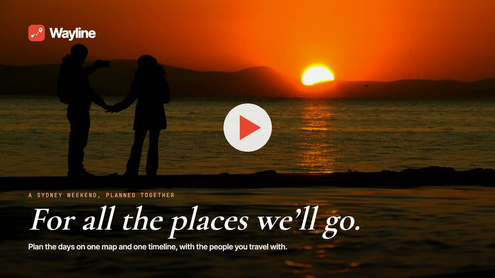
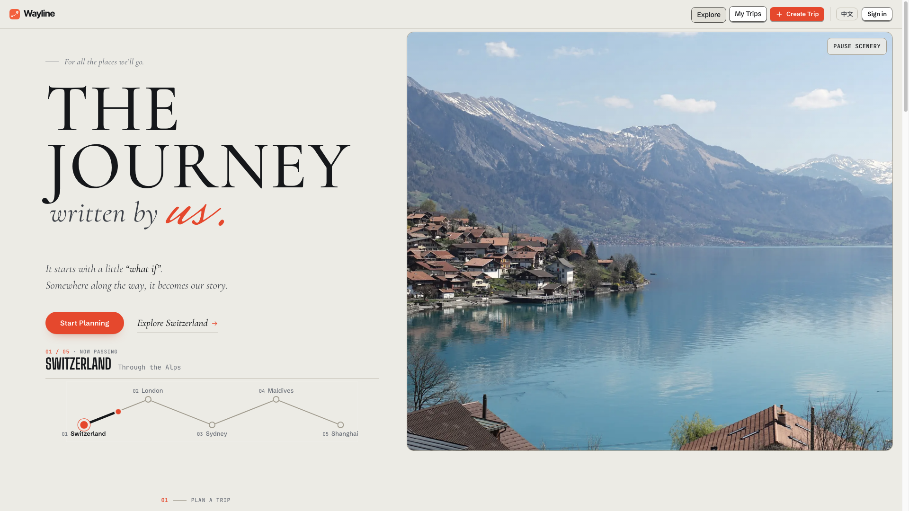
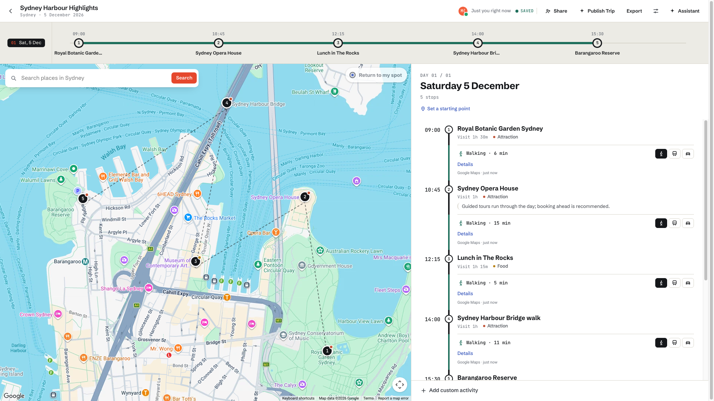
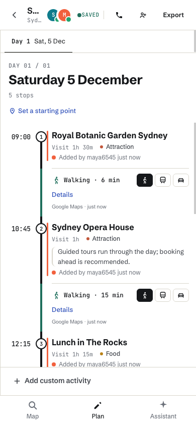

# Wayline

> People choose where they want to go. Wayline helps them figure out how to get there.

Wayline is a shared travel-planning workspace: a map, a day-by-day timeline, and a few friends working on the same trip.

Between consecutive stops, Wayline looks up real travel times and points out when a day's timing does not add up.

[Open Wayline](https://comp4020-final-lyclccylcq.fly.dev/)

## A quick start

1. Open Wayline and browse the map or ready-made trips. Create an account and sign in when you want your own plan; English and Chinese are available.
2. In My Trips, choose **New trip**, or open a ready-made itinerary and choose **Plan this trip** (**Use This Template** for a published journey). Choose dates and a starting point.
3. Search or select a place on the map, then choose **Add to Itinerary**. Adjust times and lengths on the timeline. Changes save as you make them. On a phone, use the **Map**, **Plan** and **Assistant** tabs.
4. Use **Share** to invite a friend by their registered nickname or by link. A link recipient requests access and the owner approves. Each person uses their own account and browser session; both can work on the plan. When both are online, **Call** offers a two-person voice call and needs microphone permission.
5. Open **Assistant** to inspect the day, choose fixes, preview their combined effect and apply the selection together.
6. Use **Export** for a PNG or PDF to consult on your phone. The owner can use **Publish** to share a read-only snapshot. Publishing and inviting someone to edit are separate actions.

## What good means to me

A good product should have real practical or entertainment value. I should know who it is for and what situation it will be used in. The workflow should be friendly enough that a person can use it without a manual, although a little guidance is welcome. It should also have an idea and character of its own, beyond putting another product in a new skin.

My three core tests are practical value, fitness for purpose and ease of use: there is a reason to use it, it works for its intended situation, and the person can understand how to use it. Wayline applies those tests to a small group of friends planning a short trip, especially somewhere unfamiliar. They already have some places they want to visit; the difficult part is turning those choices into a day they can understand and arrange together.

## Why I want to keep using it

I did not start Wayline just to finish a course assignment. I wanted a tool I would actually use afterwards. Its requirements came from real situations I was in, and almost everything I added had a need behind it. The map, shared plan, assistant and phone-friendly export all went through those choices. [PROCESS](https://github.com/comp4020-agentic-coding-studio/comp4020-final-lyclccylcq/blob/main/PROCESS.md) records the reasons and changes in detail.

The map makes location and distance part of the decision. The shared timeline lets us see how one person's choice changes the same plan we are both discussing. Real travel information matters; an unavailable route should remain unknown rather than become a confident guess.

Real-time interaction is central to this project. I want a platform people choose to return to, including me. Sharing a finished itinerary is useful, while live collaboration lets us think, change things and respond to each other during the planning itself. That ongoing work is the experience I want Wayline to support.

*The homepage gives the trip a travel setting, with a destination to explore and a way to start planning.*

## How planning together works

A change is saved and sent to the other open editors, appearing within about a second without a reload. An edit based on an outdated stop is refused with the current version, so a conflict becomes a choice instead of silently losing someone's work. The map and timeline show one shared plan, while each person's map view remains their own.

Private trips are visible only to their members. Collaborators can plan any stop, the starting point and transport; the owner retains trip settings, membership, publishing and deletion. Invite links last 24 hours and let an account request access for the owner to approve. Invitations by registered nickname identify the account directly ([permissions](https://github.com/comp4020-agentic-coding-studio/comp4020-final-lyclccylcq/blob/main/docs/permissions.md)).

*At 1920×1080, numbered map markers correspond to the stops in the timeline. Google travel times sit between activities, alongside the available transport choices.*

*At 390×844, Map, Plan and Assistant provide separate views of the same workspace. The day keeps its times and travel segments, with collaborators' additions identified.*

The server records significant actions and refusals against the signed-in account, leaving passwords, keys and private notes out of its logs. Two members can also talk in an audio-only call while they edit. Calls are not recorded, transcribed or passed to the AI.

## AI should be a tool I can act on

My approach came from another personal project: a fitness-logging AI agent app. Refining its AI coach taught me a practical lesson about interaction. If a task can be completed with one action, I do not want to keep chatting to make it happen.

That experience informed Wayline's task buttons and its later repair flow. Instead of choosing and confirming one fix, then repeating the process for the next problem, I can choose the fixes I want, see their combined effect and apply them together. The person still chooses what changes. I want AI to help inspect and refine the plan, with fewer exchanges needed to get the work done.

Most schedule checks come from rules: overlaps and too-short gaps are calculated from times and Google route results. Food suggestions look for places along the route and check opening hours. A model can recommend among the fixes the application has worked out; **Optimize my day** can draft a day's changes from the chosen stops and nearby Google candidates. In that draft, times already set by the traveller remain fixed.

Suggestions are previewed and selected before they are applied. If the day changes in the meantime, the old proposal is refused and its suggestions are cleared. Rule-based checks and Google suggestions also work independently of a configured AI key ([AI implementation](https://github.com/comp4020-agentic-coding-studio/comp4020-final-lyclccylcq/blob/main/docs/ai.md)).

## Where the ideas came from

My references were mainly practical and visual. Recent AI-made window-view scenery clips inspired the homepage's window-like carousel. Metro maps themselves suggested the route-and-station visual language and animation. The interaction experience from my own AI coach informed the assistant, as described above.

These are the influences I actually used. The photographs and video assets on the site have their own [credits](https://comp4020-final-lyclccylcq.fly.dev/credits); visual inspiration and the source of those assets are separate. The design choices are recorded in [ADR 0007](https://github.com/comp4020-agentic-coding-studio/comp4020-final-lyclccylcq/blob/main/docs/decisions/0007-bounded-planning-assistant.md) and [ADR 0009](https://github.com/comp4020-agentic-coding-studio/comp4020-final-lyclccylcq/blob/main/docs/decisions/0009-visual-identity-and-maintainability.md).

### Related comparisons

Robin Sloan's [*An app can be a home-cooked meal*](https://www.robinsloan.com/notes/home-cooked-app/) offers a useful comparison: software can be worthwhile because it serves particular people well. That fits my aim of making something I will keep using. Wayline's groups can change between trips, so it retains explicit accounts, invitations and privacy boundaries rather than copying his fixed-family setup.

Amershi et al.'s [*Guidelines for Human-AI Interaction*](https://www.microsoft.com/en-us/research/publication/guidelines-for-human-ai-interaction/) emphasise making capabilities understandable and making AI easy to invoke, dismiss and correct. Wayline's task buttons, selectable fixes and previews put those concerns into the planning workflow. The guidelines help explain the interaction standard; my own AI-coach work supplied the practical experience behind it.

## Sharing belongs to the tool

People can publish a journey they have designed so that someone else can read or reuse it. Sharing should start from the usefulness of the itinerary itself. An official explanation of why a plan is recommended helps explain the choice; a user's rating or written review evaluates the plan. Both can have a place in a travel tool.

A published journey is a read-only snapshot without private notes or trip membership. Editing the working trip does not update that snapshot until the owner republishes. **Use This Template** makes an independent private copy, so later changes on either side do not rewrite the other person's plan. Exporting a member's own plan as an image or PDF is another way to carry the result away from the editor.

My boundary is about what the platform is for. I want a workspace for travel design, rather than another Instagram. Ratings and reviews can remain as feedback on an itinerary. I do not want follows, social feeds or attention-seeking interaction to become the reason people use Wayline. I may add other useful feedback later, while keeping travel planning at the centre.

## What I can check

Data, permissions, persistence and logs have automated checks. Browser and audio tests also cover particular interaction and call failures. They are useful checks, but people still need to operate the interface and confirm the experience: whether the next action is understandable, the page works at their screen size, and a voice call is usable on their devices and networks.

The checked promises include private access, non-duplicating retried adds, refused stale edits, schedule arithmetic, live delivery and persistence. They are carried into the [working rules](https://github.com/comp4020-agentic-coding-studio/comp4020-final-lyclccylcq/blob/main/CLAUDE.md) and [tests](https://github.com/comp4020-agentic-coding-studio/comp4020-final-lyclccylcq/tree/main/spec).

Planning an actual route with a classmate showed that the earlier own-stop-only permissions kept passing ordinary edits back to the owner. I widened the planning rights so members could arrange the day together ([ADR 0008](https://github.com/comp4020-agentic-coding-studio/comp4020-final-lyclccylcq/blob/main/docs/decisions/0008-planning-rights-and-management.md)). That is one concrete way actual use changed what I accepted as usable.

My own use and classmates' feedback informed the changes in PROCESS. [Validation notes](https://github.com/comp4020-agentic-coding-studio/comp4020-final-lyclccylcq/blob/main/docs/final-validation-notes.md) distinguish the automated checks, real-service examples and manual observations.
