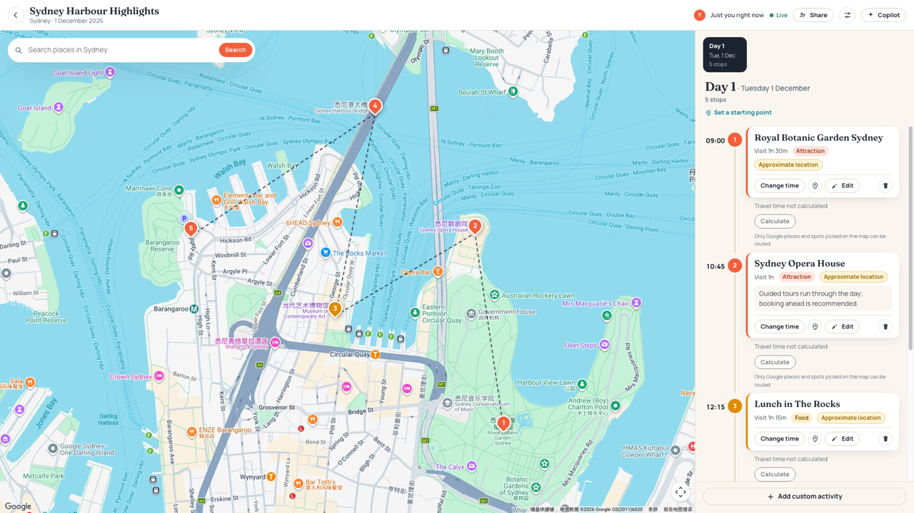
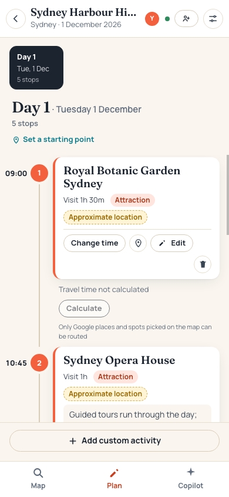
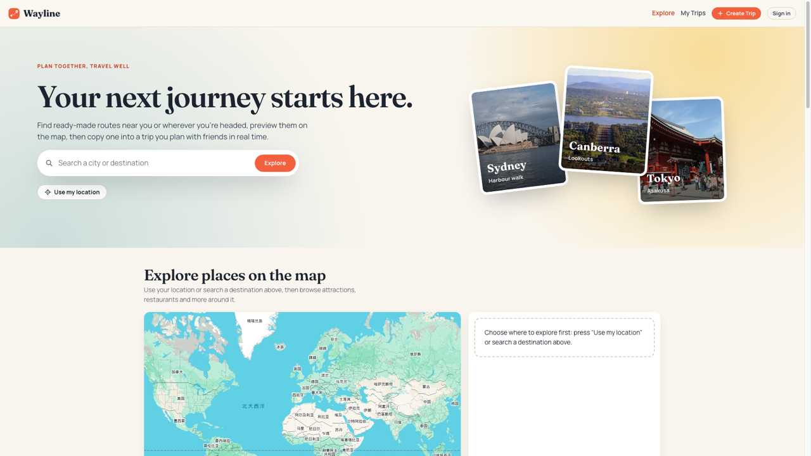

# Wayline

> People choose where they want to go. Wayline helps them figure out how to get there.

Wayline is a collaborative travel planner. A group shares one trip: an interactive map beside a day-by-day timeline. Everyone picks places, arranges them into days and sees each other's changes as they happen. Between consecutive stops Wayline looks up real travel times and points out when a plan doesn't add up.

_Screenshots from 12 October 2026: the homepage from the live site; the editor from a local copy of the same commit with real Google keys, showing a copy of a curated itinerary. Its stops have no stored Google match, so they're labelled "Approximate location" and travel times can't be calculated for them._

## From Virtual Gym to Wayline

This project began as Virtual Gym, a shared pixel-art gym where real workouts moved your character. Seeing others online changed little about anyone's experience, and its use alongside existing fitness apps was hard to justify, so in October 2026 the project pivoted to collaborative travel planning. The gym's development record stays in `PROCESS.md`, `reflections/` and `docs/decisions/`.

## Who it's for

Small groups, roughly two to six people, planning a short trip together, who care more about a plan that actually works than about discovering new places. Today that planning is spread across a map app, a shared document, a group chat and screenshots, and the hard part is fitting choices together: whether the zoo and lunch fit in one morning once the ferry is counted, and whose copy of the plan is current.

## How collaboration works

Everyone invited to a trip edits the same itinerary, which lives on the server. When someone adds a stop, moves lunch to one o'clock or changes how long the museum takes, the change is saved and then pushed to every open editor, appearing within about a second. An edit made against an outdated version is refused instead of silently overwriting someone. Trips are private: only the owner and people they invite through a revocable link can see or change them.

Two people on a trip can also talk it through in an audio-only voice call from the editor's top bar, while both keep editing the same plan. The call is between them: browser to browser over WebRTC, never recorded, transcribed or sent to the AI, and never part of the itinerary. One call has two people. Reliable calling across different networks needs a TURN relay configured on the server ([ADR 0004](docs/decisions/0004-webrtc-voice-calls.md)).

## The planned role of AI

The AI copilot helps; it doesn't decide. Overlaps and too-short gaps are calculated by plain arithmetic, from travel times Google's Routes API actually returned. The AI's job is to review a day, answer questions about it ("Is this morning too rushed?", in English or Chinese), explain conflicts and recommend among the exact fixes the app already worked out, pointing at the stops it means. It can't change the plan: every fix is previewed with its exact edits, needs a confirmation, and is refused if anyone has changed that day since the answer. Numbers shown come from the app's own calculation; the AI's words are labelled as interpretation. Each person's conversation stays in their own editor. Without a configured AI key, the rule-based checks still work and the app says AI is unavailable.

## Why this interaction should be meaningful

In Virtual Gym, other people were visible but nothing they did touched your session. In Wayline, the hope is that interaction matters because the plan is genuinely shared: one person's change shapes everyone's day, and conflicts become decisions the group makes together. That is a design intention, still to be evaluated with real groups.

## What good means here

- planning happens by touching the map and timeline, not filling in forms;
- there is one shared plan, never diverging copies;
- travel information is truthful: real route data, or a plain "unknown", and demo data is always labelled;
- the AI explains and suggests; people decide;
- a private trip stays private.

## Which claims are checked

`spec/` enforces the checkable parts: outsiders get nothing; retried adds don't duplicate; stale edits are refused; schedule maths is exact; changes reach another session, and another real browser, within a second; data survives a restart; server keys never reach the browser; no route is invented. A production audit found one gap: the server checked the starting point's version only when a request included it. That check is now required, and a test covers it (ADR 0003). Whether planning feels direct and calm is judged by people using it.

## What it deliberately doesn't do

No booking, payments, reviews, feeds, text chat or comments, AI-generated itineraries or multi-day route optimisation. Each would move decisions away from the travellers or the focus away from the shared plan. The one exception to "no chat" is the two-person voice call above: talking while both look at the same map and timeline keeps the plan at the centre, where a text channel would compete with it. No video, group calls or call recording.

## Sources

Work this definition is argued from, and against:

- Clay Shirky, [*Situated Software*](https://gwern.net/doc/technology/2004-03-30-shirky-situatedsoftware) (2004), and Robin Sloan, [*An app can be a home-cooked meal*](https://www.robinsloan.com/notes/home-cooked-app/) (2020): software for one small group, not everyone. Hence two to six travellers, and no feeds or reviews.
- Ben Shneiderman, [*Direct Manipulation: A Step Beyond Programming Languages*](https://doi.org/10.1109/MC.1983.1654471), IEEE Computer 16(8), 1983: visible objects, acted on directly, with immediate feedback. Hence the map and timeline over forms.
- Martin Fowler, [*Optimistic Offline Lock*](https://martinfowler.com/eaaCatalog/optimisticOfflineLock.html): detect a conflicting edit by its version and refuse it. Hence "refused instead of silently overwriting".
- Evan Wallace, [*How Figma's multiplayer technology works*](https://www.figma.com/blog/how-figmas-multiplayer-technology-works/) (2019): a server-authoritative alternative to operational transforms, but last writer wins per property. Wayline keeps the server's authority and refuses stale edits instead.
- Kleppmann et al., [*Local-first software*](https://www.inkandswitch.com/local-first/) (Ink & Switch, 2019): the case for offline editing and automatic merging (CRDTs). Wayline gives up offline editing for one copy on the server (ADR 0003).
- Amershi et al., [*Guidelines for Human-AI Interaction*](https://doi.org/10.1145/3290605.3300233), CHI 2019: make clear what the system can do and why, and make it easy to dismiss or correct. Hence a copilot that explains and proposes, and never applies.
- Google Maps Platform, [Places API policies](https://developers.google.com/maps/documentation/places/web-service/policies): attribution and limits on storing Google content. Hence route data only from Google, or "unknown".
