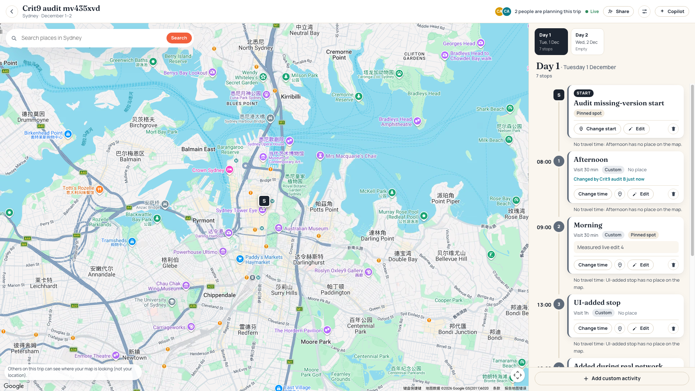
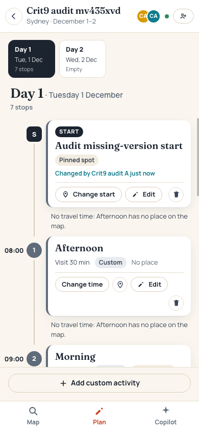

# Crit 9 notes (factual record and evidence pack)

The evidence behind `PROCESS.md`, ADR 0003 and `reflections/crit-9.md`. Every
statement here says where it comes from, kept in three groups:

- **automated checks** in `spec/`, run by `pnpm check` locally and in CI;
- **earlier manual measurements**, taken in agent sessions on 2026-10-12 and
  recorded in [`c8b258c`](https://github.com/comp4020-agentic-coding-studio/comp4020-final-lyclccylcq/commit/c8b258c);
- **the independent production audit**, run on 2026-10-12 against commit
  `54c282e` by a separate session. Its results are reported here as the audit
  reported them. Raw logs from it aren't in the repo; its two screenshots are.

Crit 9 brief ("All at once"): the app is real-time by the brief's definition
and deployed by the cutoff; one decision about how the app behaves with
several people is written down with the options and what the choice costs,
and the author can say why; the repo shows the process (commits, `PROCESS.md`,
`reflections/crit-9.md`); the author can account for how they directed,
grounded and corrected the work. Crit group Bada: cutoff Monday 12 October
2026, 13:30 (Canberra time); session 15:30–17:00.

## Commits since the pivot

| Commit | What it shows |
|---|---|
| [`6305228`](https://github.com/comp4020-agentic-coding-studio/comp4020-final-lyclccylcq/commit/6305228) | Virtual Gym replaced by Wayline; SSE hub, versioned edits, invites already in this first build |
| [`0953ec9`](https://github.com/comp4020-agentic-coding-studio/comp4020-final-lyclccylcq/commit/0953ec9) | The pivot documented in `PROCESS.md` and `README.md` |
| [`4e0b815`](https://github.com/comp4020-agentic-coding-studio/comp4020-final-lyclccylcq/commit/4e0b815) | Public discovery homepage |
| [`a32c15b`](https://github.com/comp4020-agentic-coding-studio/comp4020-final-lyclccylcq/commit/a32c15b) | Explore Map; a stray "false" traced to native `replaceChildren()` and guarded by a spec check that scans `public/` |
| [`a1a431c`](https://github.com/comp4020-agentic-coding-studio/comp4020-final-lyclccylcq/commit/a1a431c) | Remembered location; licensed Wikimedia photos with credits |
| [`7799fab`](https://github.com/comp4020-agentic-coding-studio/comp4020-final-lyclccylcq/commit/7799fab) | Planning from the map: place clicks, nearby exploring, custom spots, a starting point |
| [`b4bb133`](https://github.com/comp4020-agentic-coding-studio/comp4020-final-lyclccylcq/commit/b4bb133) | Crit 9 gap review: start changes versioned (409 instead of silent replace), remote changes no longer move another person's map, membership checked before configuration; two-browser tests |
| [`c8b258c`](https://github.com/comp4020-agentic-coding-studio/comp4020-final-lyclccylcq/commit/c8b258c) | Earlier production latency and access checks recorded |
| [`19fbd1c`](https://github.com/comp4020-agentic-coding-studio/comp4020-final-lyclccylcq/commit/19fbd1c) | Reading about a place separated from scheduling it; "nothing is shared until Confirm & add" |
| [`3f27110`](https://github.com/comp4020-agentic-coding-studio/comp4020-final-lyclccylcq/commit/3f27110) | Days ordered by time on the server; map-view presence with edge arrows; meals |
| [`54c282e`](https://github.com/comp4020-agentic-coding-studio/comp4020-final-lyclccylcq/commit/54c282e) | My Trips cover photos; ADR 0003 accepted; first version of these notes |

## How the real-time part works (as deployed at `54c282e`)

- Edits are HTTP requests; each runs in one SQLite transaction that bumps the
  trip's `rev`, then the whole snapshot goes to every member's open SSE
  stream. Clients ignore older revisions; a reconnecting stream starts with a
  fresh snapshot. (`src/trips.ts` `mutate()`, `src/realtime.ts`)
- Concurrency: per-activity `baseVersion` → 409 with the current activity;
  the dialog offers "Load their version" or "Save mine over theirs". Adds are
  idempotent by `clientId`. Order is decided by the server from times, so it
  needs no version.
- The starting point: the editor always sends the version it saw (a number,
  or `null` for "no start yet"), and a mismatch is a 409. At `54c282e` the
  server only checked when the field was present (`setStart`: `if
  (input.baseVersion !== undefined && …)`), so a request that left it out
  replaced the start unchecked. Only the app's own UI, which never sends such
  a request, was protected. Fixed in [`7278cfe`](https://github.com/comp4020-agentic-coding-studio/comp4020-final-lyclccylcq/commit/7278cfe): the field is required, and a
  missing or malformed one is a 400 that writes nothing.
- Permissions: owner and collaborators via revocable 256-bit invite links;
  non-members get 404 on the trip, its stream and every edit.
- Shared vs personal: the itinerary (stops, times, order, start, meals) is
  shared and saved. Map camera, open place card, search results, nearby
  exploring and the start being chosen stay in the browser. Where each tab's
  map is looking is shared live but in memory only: never saved, never a
  revision, gone with the tab or after a minute.
- One Fly machine; the in-memory hub depends on it (ADR 0003, `fly.toml`,
  `--ha=false`).

## Evidence

### Automated checks

- `pnpm check` at `54c282e`: type check plus 14 test files, 110 tests, none
  skipped; the GitHub `check` and `deploy` jobs for that commit succeeded.
- What they cover, by file: delivery to another open stream within a second,
  committed-only broadcasts and rising revisions, and a removed member's
  stream closing (`spec/realtime.test.ts`); two real Chrome sessions seeing
  each other's adds, removals, retimes, start changes and simultaneous adds
  (`spec/browser.test.ts`); a start change based on a replaced start refused
  with 409 (`spec/start.test.ts`); the map-view presence API: relayed,
  dropped, 404 for outsiders, 400 for bad input, never a revision
  (`spec/order.test.ts`); data and sessions kept across a restart
  (`spec/restart.test.ts`, against a local server).
- Since [`7278cfe`](https://github.com/comp4020-agentic-coding-studio/comp4020-final-lyclccylcq/commit/7278cfe), a start change with `baseVersion` missing, a string or a
  fraction is refused with 400 and changes nothing (`spec/start.test.ts`; run
  against the old code, it failed with the audit's 200). 111 tests.
- Not covered by any check: the client keeping its map still when a snapshot
  arrives; the edge arrows; recovery after a production restart.
- `pnpm check:evidence` passes when *any* of `crit-8.md`, `crit-9.md` or
  `crit-10.md` exists, so it doesn't show that the Crit 9 reflection is in
  place.

### Earlier manual measurements (agent sessions, 2026-10-12, [`c8b258c`](https://github.com/comp4020-agentic-coding-studio/comp4020-final-lyclccylcq/commit/c8b258c))

- Healthy sync, two Chrome sessions, from the sender's request to the
  receiver's render, n=10 each: local medians 29–31 ms (max 34 ms);
  production medians 30–42 ms (max 86 ms), Fly `syd`.
- Reconnect after a *local server restart* with both pages open: the other
  page reconnected by itself and showed a new change 0.8 s after it was made.
- Access: a signed-in outsider got 404 for the trip, its stream, a start
  change and a rename.
- Map-view presence on production (before `54c282e`): an off-screen
  collaborator showed as an edge arrow pointing the right way; clicking it
  moved only the clicker's map; the trip's revision didn't change.

### Independent production audit (2026-10-12, at `54c282e`)

Reported by the audit; not rerun for these notes. Two isolated Chrome
sessions on the live Fly URL, at 1920×1080 and 390×844. It first confirmed
that local `HEAD`, GitHub `main` and the deployment matched (key server and
frontend files hashed equal), and that Fly ran one machine in `syd` with the
`/data` volume.

Timings run from the sender starting its request to the peer's rendered DOM
showing the change, including the polling used to detect it. They are small
samples, not a performance guarantee.

| Healthy sync | Observed |
|---|---|
| Add, placed by its time | 29 ms |
| Retime that changes the order | 28 ms |
| Untimed reorder | 28 ms |
| Delete | 29 ms |
| Starting point | 42 ms |
| Content edits, n=5 | 44, 41, 43, 44, 45 ms (median 44, max 45) |

| Behaviour | Observed |
|---|---|
| Invite link, collaborator joins | Passed |
| Non-member reads and edits; collaborator trying owner-only actions | Refused |
| Stale activity edit | 409; both "Load their version" and "Save mine over theirs" worked |
| Reload | Itinerary preserved |
| Real network interruption | "Reconnecting" shown; changes made while one side was offline appeared there 2057 ms after its connection came back, without a reload |
| Collaborator removed | Trip and event-stream requests returned 404 |
| My Trips | The Sydney cover photo loaded |
| Start change with a stale `baseVersion` | 409 |
| **Start change with no `baseVersion`** | **200, start overwritten: the defect above, reproduced in production (fixed afterwards in [`7278cfe`](https://github.com/comp4020-agentic-coding-studio/comp4020-final-lyclccylcq/commit/7278cfe))** |

Not tested by the audit: recovery after a production restart or redeploy
(the network test is a different thing); the map staying still for one
person when another edits, and the edge arrows, on a real Google map.

Clean-up: the audit deleted its test trips and signed out. Four empty test
accounts remain in production, because the app has no way to delete an
account.

Screenshots, at the end of the audit (the start's title is the audit's own,
from the missing-version test):

## Where direction or a check changed the outcome

1. **Gaps found by review, not by the first build** ([`b4bb133`](https://github.com/comp4020-agentic-coding-studio/comp4020-final-lyclccylcq/commit/b4bb133)):
   the start could be silently overwritten by a simultaneous change; a
   collaborator's change reset everyone's map; a route request reached a
   configuration check before the membership check. Version and access fixes
   have automated tests; map preservation was checked manually. The
   independent audit later found the start check incomplete. It was fixed
   in [`7278cfe`](https://github.com/comp4020-agentic-coding-studio/comp4020-final-lyclccylcq/commit/7278cfe), with a test that failed on the old code and a `CLAUDE.md`
   rule.
2. **Questions put to the author and the answers taken**, recorded as rules
   in `CLAUDE.md` in the commits that implemented them:
   - travel times stay on a button rather than recalculating on every edit
     ([`7799fab`](https://github.com/comp4020-agentic-coding-studio/comp4020-final-lyclccylcq/commit/7799fab));
   - no view-only links yet ([`b4bb133`](https://github.com/comp4020-agentic-coding-studio/comp4020-final-lyclccylcq/commit/b4bb133));
   - reading about a place kept apart from scheduling it, at the author's
     request ([`19fbd1c`](https://github.com/comp4020-agentic-coding-studio/comp4020-final-lyclccylcq/commit/19fbd1c));
   - time decides order, and moving a timed stop means changing its time,
     chosen over keeping free manual reordering; per-trip meal times;
     "Change place" ([`3f27110`](https://github.com/comp4020-agentic-coding-studio/comp4020-final-lyclccylcq/commit/3f27110)).
     This changed a `README.md` sentence ("moves lunch" became "moves lunch
     to one o'clock") and the product rules.
3. **A UI bug traced to its cause and guarded** ([`a32c15b`](https://github.com/comp4020-agentic-coding-studio/comp4020-final-lyclccylcq/commit/a32c15b)):
   the stray "false" came from native DOM calls; the fix covered six call
   sites, and a spec check now fails on the pattern.
4. **Measured, not assumed**: the earlier measurements
   ([`c8b258c`](https://github.com/comp4020-agentic-coding-studio/comp4020-final-lyclccylcq/commit/c8b258c))
   and the independent audit above.

Not in the history (observed during sessions, not committed): a CI run on
[`a32c15b`](https://github.com/comp4020-agentic-coding-studio/comp4020-final-lyclccylcq/commit/a32c15b)
failed because Chrome didn't start within 10 s and passed on a rerun (visible
in the GitHub Actions log); while building time ordering, new tests showed the
server answered the person making a change in the old order until the fix in
[`3f27110`](https://github.com/comp4020-agentic-coding-studio/comp4020-final-lyclccylcq/commit/3f27110).

## Known limitations

- Recovery after a production restart or redeploy is untested; reconnect was
  measured after a local restart and after a real network drop.
- Keeping the map still for one person when another edits, and the edge
  arrows, were checked by hand before `54c282e` and not independently since.
- My Trips photos only cover trips copied from a template or near a curated
  city (within 100 km); other trips keep the colour band.
- No view-only links; every invitee can edit.
- One machine only: the hub is in memory.
- The AI copilot hasn't been run with a real model key; its rule-based checks
  work without one.
- No evaluation with real groups yet.

## Crit 9 readiness

| Requirement | State |
|---|---|
| Real-time, deployed: a change reaches other sessions in about a second, no reload | Done; automated checks plus two rounds of production measurement |
| One multi-user decision written down with options and costs | ADR 0003, accepted; the start-version defect and its fix are in its History |
| Commits that grew with the work | Done (table above) |
| `PROCESS.md` rewritten for Crit 9 | Complete; current Wayline account, stack/workflow rationale and cited decisions |
| `reflections/crit-9.md` | Complete; both standing prompts answered, 258 words |
| Account of directing, grounding, correcting | Evidence above; the account is the author's |
| Checks green, site live at the cutoff | Verified on 12 October at [`095a40f`](https://github.com/comp4020-agentic-coding-studio/comp4020-final-lyclccylcq/commit/095a40f): local HEAD, GitHub main and Fly release 23 matched; [CI](https://github.com/comp4020-agentic-coding-studio/comp4020-final-lyclccylcq/actions/runs/38161656198) passed all 14 files and 111 tests, evidence checks and deployment. Recheck after any later push; freeze by the 13:30 cutoff (the 13:45 sweep is not extra editing time). |
