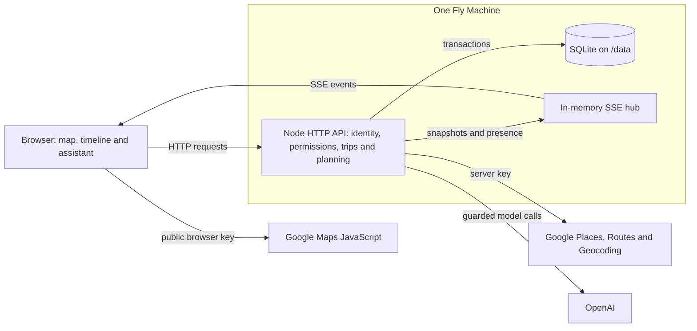

# Final engineering and workflow notes

These details accompany the shorter [PROCESS overview](../PROCESS.md). They retain the implementation trade-offs, failure cases and verification scope from the Final documentation review. The functional baseline and dated checks are identified below; this reorganisation does not change the application. Full personal design accounts remain in the [decision records](decisions/0005-project-theme-and-pivot.md).

## Implementation and engineering trade-offs

### Runtime and deployment

The pivot retained Node 24's HTTP server, built-in SQLite and browser JavaScript modules. TypeScript runs directly through type stripping, with no frontend compilation step or ORM. This fitted the course's one shared-CPU Fly Machine, 256 MB of memory and retained /data volume. It also left routing, DOM updates and module lifetimes for the application to manage. The original stack comparison is in [ADR 0001](../docs/decisions/0001-plain-node-and-sqlite.md).

The dependency position changed as the project grew. The final Dockerfile installs production dependencies from the lockfile, including the OpenAI SDK; it then copies the source and public assets into the image. SQLite holds durable state on the volume, while live connections remain in memory. A second machine with a separate database would have its own state and counters, so expansion would require shared storage and event coordination ([Dockerfile](../Dockerfile), [Fly configuration](../fly.toml), [runtime dependencies](../package.json)).

The 29 October refactor extracted request logging, planning orchestration and browser sharing from larger modules. It made responsibilities easier to follow while retaining behaviour through existing checks. It also shows the maintenance cost of the small-stack choice: avoiding a framework did not remove the need to revise the structure ([dfce3ef](https://github.com/comp4020-agentic-coding-studio/comp4020-final-lyclccylcq/commit/dfce3ef853434c8d07d79f855dc1daba4a51d119)).

### Durable state and safe edits

Accounts, membership, trips, days, activities and transport segments are separate database entities. Activities retain their identities when their positions change. The server places the starting point first, timed stops in time order and untimed stops in the order people chose; equal times preserve their earlier order. A transport segment belongs only between neighbouring stops on the same day. An edit removes segments whose endpoints are no longer neighbours, and changed route inputs can make stored results stale.

A trip mutation runs in one SQLite transaction, normalises order, prunes invalid segments and increments the trip revision before live notification. Several additional checks protect different kinds of interaction:

| Check | Purpose |
|---|---|
| Trip rev | Reject an older HTTP/SSE snapshot arriving after newer displayed state |
| Activity baseVersion | Return 409 and the current activity when someone else changed the stop |
| Required starting-point baseVersion | Reject missing or malformed versions; null explicitly means there was no start |
| Add clientId | Return the existing activity when the same add is retried |
| Day fingerprint | Refuse a preview whose underlying day has changed |

The conflict interface offers loading the current version or deliberately saving against that version. Server-owned order is derived from current activities and times; it does not use the same content-version check. These distinctions are implemented in the [trip store](../src/trips.ts) and covered by [ordering](../spec/order.test.ts), [start](../spec/start.test.ts) and [itinerary tests](../spec/itinerary.test.ts).

### Live delivery and separate personal views

Edits use HTTP. After a successful commit, the server broadcasts a whole-trip snapshot to members through SSE. A new or reconnected stream begins with the current snapshot, so it can catch up without replaying missed events. Revisions prevent a late older response from replacing newer trip state.

Polling would repeatedly ask whether anything had changed. WebSockets offered two-way communication, but writes already used HTTP; SSE supplied the remaining server-to-browser path. Whole snapshots simplify recovery and avoid a client-side diff-merging protocol, at the cost of repeated data. That is acceptable for the present trips of tens of stops, with no offline editing or automatic text merging ([ADR 0003](../docs/decisions/0003-sse-snapshots-and-versioned-edits.md)).

Map-view presence uses the live hub but stays in memory, expires and disappears on disconnect. It is separate from the saved itinerary and does not increase its revision. Receiving a snapshot updates the plan without moving another person's map camera ([live hub](../src/realtime.ts)).

### Identity, permissions and observable actions

Wayline replaced the gym's anonymous pass with accounts. Passwords use salted scrypt hashes; random session tokens are stored as hashes and resolved from an HttpOnly cookie. The request body cannot choose the acting user or role ([account implementation](../src/auth.ts)).

The stores call the central permission module before performing operations. The final rights and the classmate planning experience behind their revision are recorded in [ADR 0008](../docs/decisions/0008-planning-rights-and-management.md). Non-members cannot read a private trip or open its stream; removal closes their existing trip streams. Invite tokens are hashed, revocable and valid for 24 hours, with approval tied to the requesting account. Publications, export links and copies retain the separate data and access boundaries described in [sharing notes](../docs/permissions.md) and [ADR 0010](../docs/decisions/0010-portable-itinerary-output.md).

Structured JSON logs make these decisions observable. AsyncLocalStorage carries a requestId and the session-resolved user into the business event and its subsequent broadcast. Logs distinguish successful actions, denied operations and failures, while excluding private notes, coordinates and credentials. Map-view updates, keep-alives and signalling payloads are omitted from routine logging. This supports tracing what happened; a browser check is still needed to establish what the other person saw ([logging design](../docs/logging.md), [logging tests](../spec/logging.test.ts), [request-event tests](../spec/request-log.test.ts)).

### External data and model validation

Schedule arithmetic belongs to code, with travel durations supplied by Google or left unknown. The real-service correction in [a005e90](https://github.com/comp4020-agentic-coding-studio/comp4020-final-lyclccylcq/commit/a005e902ad410000e0aeb916edb93f1a325c866b) removed the silent substitution of driving when transit had no route. A fluent explanation could not make that substitution respect the traveller's excluded modes.

Food and nearby exploration can use Google candidates and rules without calling a model. Model-assisted recommendations and day optimisation pass through a provider adapter, structured output and application validation. Candidate identifiers must come from supplied choices, existing fixed times are protected, and selected changes are previewed before permission and fingerprint checks at application. Food suggestions also need opening-hour checks; available restaurant data cannot guarantee dietary suitability ([planning orchestration](../src/planning.ts), [planner](../src/planner.ts), [AI implementation](../docs/ai.md)).

The homepage's ready-made-trip matching retrieves and ranks existing curated itineraries from structured inputs; it does not generate a trip with an LLM. Credential and consumption controls remain in [ADR 0011](../docs/decisions/0011-api-credentials-and-usage-controls.md). Optional two-person voice has a separate signalling, media and relay path, recorded in [ADR 0004](../docs/decisions/0004-webrtc-voice-calls.md).

## Directing the agent and correcting its work

I supplied the use cases, scope changes and feedback, then used prompts to ask Claude to implement them. I judged whether the resulting interaction was the one I wanted; tests and separate review checked whether its implementation obeyed the rules. Changing the chatbot into buttons and rejecting the artificial window effects were examples of product judgement that a successful build could not supply. The cost of this division was reviewing substantial agent-generated changes, especially once maintenance became a concern.

Working rules in [CLAUDE.md](../CLAUDE.md) carried constraints into later sessions, while spec/ held their testable consequences. Separate reviews checked behaviour against the running version, including whether local, GitHub and deployed files agreed. This challenged assumptions that a single implementation session had missed, with concrete corrections in the record.

### Turning an audit finding into a lasting rule

The starting-point conflict check is one complete example. The normal editor sent baseVersion, so ordinary use appeared protected. The Crit 9 production audit sent a request without that field and found that the server accepted it and replaced the start. The server had been relying on the client's behaviour.

The correction required a valid version, or null when no start existed, and refused missing or malformed values with 400 before any write. A regression test sent the missing field, a string and a fractional value, then checked that the original start remained. The [commit record](https://github.com/comp4020-agentic-coding-studio/comp4020-final-lyclccylcq/commit/7278cfee5dd14cadd063479a29bf3774b0465841) reports that this test failed against the old implementation with the audit's 200 response.

The same commit changed CLAUDE.md to state both the required field and the failure that made it necessary. That carried the correction beyond one patched function: a later agent could read the rule, and the test could reject a reintroduced gap. The evidence is the linked server change, [regression test](../spec/start.test.ts) and working-rule change, rather than another successful retry.

### Testing the failure, including work that finishes late

Later review found three related lifetime problems: an old reload could replace newer streamed state, repeated share dialogs accumulated listeners, and optimisation continued after its caller left. The [8d2aec6](https://github.com/comp4020-agentic-coding-studio/comp4020-final-lyclccylcq/commit/8d2aec6d856cba90f3d7c25de3a83a71440b77b7) corrections dealt with state ordering, listener cleanup and upstream cancellation. The cancellation test holds the provider response open, disconnects the caller, and checks that the usage record closes as cancelled, the concurrency slot is released and no draft remains. It also covers leaving during preparation, before a model call should start ([cancellation tests](../spec/plan-cancel.test.ts)).

The final navigation review found a slow itinerary response could draw over the homepage or sign-in page after navigation. Page-lifetime checks and delayed-response tests covered both success and failure, at desktop and phone sizes, including a map that finished initialising after its page was gone ([275dde8](https://github.com/comp4020-agentic-coding-studio/comp4020-final-lyclccylcq/commit/275dde8d53e4b9370d3420bdb72d7dd71320d55d), [navigation tests](../spec/browser-navigation.test.ts)). These tests reproduced the timing of the failure; a normal successful request would not have exercised it.

### Matching checks to changes

The checking policy changed on 31 October. It called for visual inspection of styles and unpinned copy at both marking viewports, and relevant tests and type checks for client or server changes. Before a commit, push or deploy, the policy retained the broader suite without voice-browser tests. Voice changes required those audio tests separately, because they occupied the microphone and speakers; CI retained its full suite. The mapping was written into CLAUDE.md so later sessions could select checks and report what ran ([574173d](https://github.com/comp4020-agentic-coding-studio/comp4020-final-lyclccylcq/commit/574173d39fac5b01d8555686741a4465d53e9223)).

This reduced repeated unrelated checks during iteration, at the cost of maintaining an accurate mapping between changes and tests. Release checks, independent browser use and my visual judgement still had distinct jobs. Passing one of them did not make the others unnecessary.

## Evidence and remaining limits

The functional baseline is [a5f7401](https://github.com/comp4020-agentic-coding-studio/comp4020-final-lyclccylcq/commit/a5f74014b3165d85ae5c9ec55161eecb2fe49f86). Its [CI run](https://github.com/comp4020-agentic-coding-studio/comp4020-final-lyclccylcq/actions/runs/42339790425) passed 386 tests. A separate freeze review passed 367 functional tests and matched 31 delivered public files to the frozen source. The difference is scope: the local review omitted 17 voice-browser tests and two course release invariants, which the full CI covered. The five destination entry paths were inspected at 1920×1080 and 390×844. [Final validation notes](../docs/final-validation-notes.md) record the checks and exclusions.

| Evidence | What it establishes |
|---|---|
| Store/API tests with controlled providers | Permissions, versions, schedule rules, error paths and usage accounting |
| Independent browsers and delayed responses | Visible collaboration, conflict handling, navigation and cleanup |
| Recorded real-service checks | Specific Google/model requests and end-to-end examples at the recorded version |
| Deployment checks and file comparison | Release availability and the content of selected delivered assets |

The [Crit 9 notes](../docs/crit-9-notes.md) distinguish healthy updates observed in 28–45 ms from recovery about 2.1 seconds after a production network drop ended. They cover a local restart and a production network drop, without establishing editor recovery across a production restart. The [Crit 10 notes](../docs/crit-10-notes.md) separately record real API examples and the faults those checks exposed.

These results support particular behaviours, not a general guarantee of service quality. Provider stand-ins cannot establish live availability, a few model examples cannot establish broad recommendation quality, and an asset hash cannot establish every backend behaviour. Crit and classmate feedback informed the decisions above; long-term planning efficiency, wider network conditions and multi-machine operation remain outside the evidence.

## Keeping API credentials and consumption under control

Connecting maps, place search, routes and model-assisted planning also made API security an operational decision. My choice was to keep deployment credentials in Fly secrets and add restrictions on API use, including request frequency and usage allowances. I needed to consider both where a key was stored and what could happen when the application used it. Even without a leaked credential, repeated requests through the normal interface could consume a paid service's allowance.

Fly secrets supplies credentials as runtime environment variables, keeping them separate from the source code and image. Local development uses a gitignored configuration file. The deployed application can obtain its configuration independently of my laptop. I also separated the intentionally public Google browser map key from the server key for Places, Routes and Geocoding; the OpenAI key remains on the backend. The browser key needs website/API restrictions because visitors must receive it to load the map ([a32c15b](https://github.com/comp4020-agentic-coding-studio/comp4020-final-lyclccylcq/commit/a32c15b76dda04bee215e8d42459f2f926a42d40)).

For model calls, the implementation provides configurable defaults of 100 admitted requests per UTC day, three concurrent calls and a 400,000-token daily admission threshold, shared across the application. Usage is recorded in SQLite, so restarting against the same retained database does not reset the daily count. Checks and reservations happen together before the provider is contacted, and admitted failures still consume a request. Output limits, timeouts and disabled automatic retries add boundaries to each call ([b20fc88](https://github.com/comp4020-agentic-coding-studio/comp4020-final-lyclccylcq/commit/b20fc8895863ef981768b88a3609030ff23ea226)). Public place and route endpoints also have short-term per-IP throttles, although these counters are held in memory rather than in the persistent AI allowance.

This choice has costs and limits. One person's repeated attempts can exhaust the shared AI allowance, and the token threshold is not an exact monetary ceiling: output is reserved before input usage is known, and completed calls are reconciled using the usage the provider returns. Provider-side API restrictions, quotas and any explicitly enforced spend cap address another part of the risk. A budget notification alone cannot be treated as a stop mechanism, and a key used directly outside Wayline would bypass its application checks. [ADR 0011](../docs/decisions/0011-api-credentials-and-usage-controls.md) records these boundaries, the implementation defaults and the distinction from live provider-console settings.
